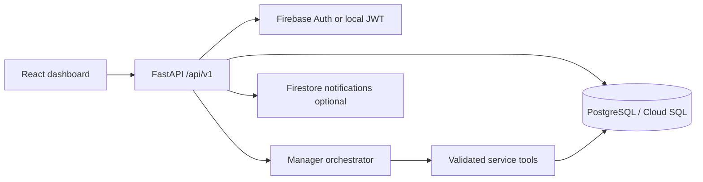

# OpsPilot AI

OpsPilot AI is a tenant-aware operations platform for managing projects, workforce capacity, releases and human approvals. The local MVP provides a functional FastAPI + PostgreSQL backend, React dashboard, deterministic analytics, and a controlled multi-agent orchestration layer.

## Quick start

```powershell
Copy-Item .env.example .env
docker compose up --build
```

In another terminal seed the demo tenant:

```powershell
docker compose exec api python -m app.seed
```

Open `http://localhost:8000/docs`; start the frontend separately with `cd frontend; npm install; npm run dev`.

For a Docker-free backend, set `DATABASE_URL=sqlite:///./opspilot.db`, then run `cd backend; python -m venv .venv; .\.venv\Scripts\python -m pip install -r requirements.txt; .\.venv\Scripts\python -m app.seed; .\.venv\Scripts\uvicorn app.main:app --reload`.

## Local demo credentials

`admin@acme.test` / `DemoPass123!` (admin) and `manager@acme.test` / `DemoPass123!` (manager). These exist only after seeding and must never be used outside local development.

## Architecture



See [docs/architecture.md](docs/architecture.md), [docs/agent-design.md](docs/agent-design.md), [docs/deployment.md](docs/deployment.md), and [BUILD_STATUS.md](BUILD_STATUS.md).
